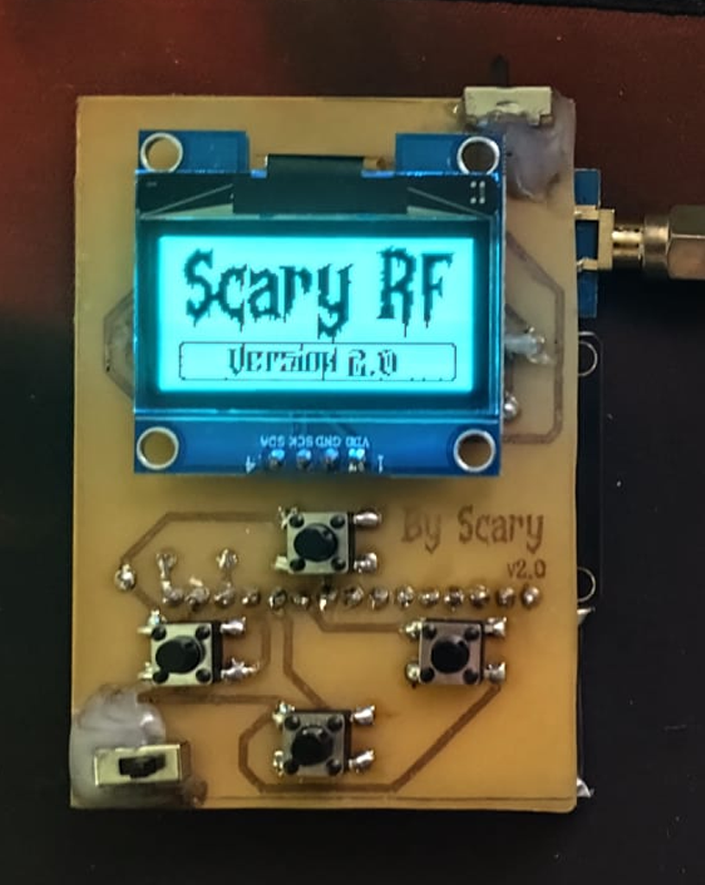
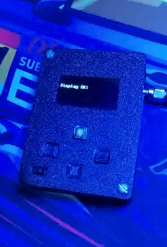
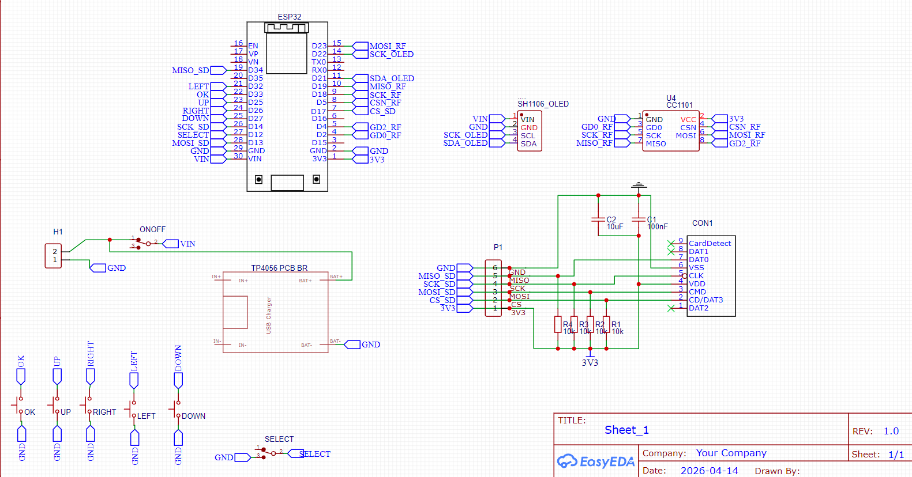

# 🦇 Scary-RF

<p align="center">
  
  
</p>

<p align="center">
  <b>Low-cost • Open-Source • ESP32 + CC1101 • Sub-GHz RF Tool</b><br/>
  <sub>+ WiFi &amp; BLE tools on the side</sub>
</p>

<p align="center">
  
  
  
  
</p>

---

## 📖 Contents

- [Overview](#-overview)
- [Features](#-features)
- [Menu map](#-menu-map)
- [Hardware](#-hardware)
- [Pinout](#-hardware-pinout-esp32)
- [Controls](#-controls)
- [Configuration](#-configuration)
- [Bad-BLE (DuckyScript)](#-bad-ble--ducky-script)
- [Installation](#-installation)
- [Roadmap](#-roadmap)
- [License](#-license)
- [Disclaimer](#-disclaimer)

---

## 📡 Overview

**Scary-RF** is a low-cost, open-source **Sub-GHz RF tool** built around an **ESP32** and a **CC1101** transceiver.

Its **main job is sub-GHz RF**: capturing, replaying, analyzing, brute-forcing and generating OOK signals, plus decoding 433 MHz sensors. On top of that, it also packs **WiFi** and **Bluetooth LE** tools as extras:

- 📻 **Sub-GHz (CC1101, 300–928 MHz)** — the core of the device.
- 📶 **WiFi (ESP32)** — targeted 802.11 deauthentication.
- 🔵 **Bluetooth LE (ESP32)** — advertising spam, tracker scan/clone/spoof, device scanner, GATT explorer and a rogue HID keyboard.

Everything runs on a 1.3" OLED with a 5-button D-pad, stores files on a MicroSD card, and is powered by a battery.

This project is for **educational, experimental and RF-research purposes**.

---

## 🚀 Features

### 📻 Sub-GHz (CC1101) — main function

- 📡 **Replay** — capture and re-transmit fixed-code OOK remotes (315 / 433 / … MHz), with protocol name recognition
- 📊 **Raw** — capture and replay any OOK waveform by bit-bang (works even when the code can't be decoded)
- 🔍 **Analyser** — scan the frequency list and lock onto the strongest signal
- 🎲 **Brute (De Bruijn)** — brute-force fixed-code gates with an adjustable clock (TE); hidden AUTO mode sweeps every clock
- 📈 **Spectrum** — RSSI bars across a band, with peak marker
- 🌡️ **Sensors** — decode 433 MHz weather sensors (Nexus, Acurite 609, Prologue, LaCrosse TX)
- ✍️ **Manual** — enter frequency + protocol + bits + hex code and transmit
- ▶️ **Test All** — transmit every `.sub` in a chosen folder, one after another
- 💾 **Save / load** captures in Flipper **`.sub`** format (Princeton keys + RAW)

### 📶 WiFi

- **Deauther** — sniffer-based *targeted* 802.11 deauthentication (single AP or all)

### 🔵 Bluetooth (BLE)

- 📢 **BLE Spam** — Apple, Windows (Swift Pair), Android (Fast Pair), Samsung (EasySetup) or All, with per-packet MAC rotation
- 🔖 **Presence Tags** — scan / **clone** nearby BLE trackers (AirTag, Tile, Samsung Tag) and **spoof** them (incl. Spoof All)
- 🔎 **BLE Scan** — list nearby devices (name, MAC, RSSI, manufacturer / service)
- 🧩 **GATT Explorer** — connect to a device, enumerate characteristics and read / write them
- ⌨️ **Bad-BLE** — rogue BLE keyboard that runs **DuckyScript** files from the SD card

### 🗄️ System

- 📁 **Files** — browse the SD card, transmit `.sub`, delete files (hold ▶ 3 s to delete a folder)
- ⚙️ **Config** — set the default frequency and the BLE device name; persisted to `/scaryrf.cfg`
- 📟 Real-time OLED UI with a consistent command bar

---

## 🗺 Menu map

```
Scary-RF
├── RF Tools          ← main function (sub-GHz)
│   ├── Replay        capture + replay OOK remotes
│   ├── Raw           raw waveform capture / replay
│   ├── Analyser      find the active frequency
│   ├── Brute         De Bruijn brute-force (adjustable TE)
│   ├── Spectrum      RSSI spectrum
│   ├── Sensors       433 MHz sensor decoding
│   ├── Test All      transmit every .sub in a folder
│   └── Manual        build + transmit a code by hand
├── Wifi
│   ├── Evil portal   (planned)
│   ├── Deauther      targeted 802.11 deauth
│   └── Internet      (planned)
├── Bluetooth
│   ├── BLE Spam      Apple / Windows / Android / Samsung / All
│   ├── Presence Tags Scan · Spoof AirTag / Samsung / Tile / All
│   ├── BLE Scan      device scanner + GATT explorer
│   └── Bad-BLE       BLE keyboard (DuckyScript)
├── Files             SD card browser
└── Config            default frequency + device name
```

---

## 🛠 Hardware

- **ESP32** (dev module)
- **CC1101** sub-GHz transceiver
- **1.3" OLED** display (SH1106, 128×64, I²C)
- **MicroSD** card module (HSPI)
- 6 push buttons (5-way D-pad + a reserved switch)
- Li-ion battery + charging/regulator board
- Custom etched copper PCB

---

## 🔌 Hardware Pinout (ESP32)

| Component     | Pin | Function              |
|---------------|-----|-----------------------|
| CC1101 RX     | 4   | RF data reception     |
| CC1101 TX     | 2   | RF data transmission  |
| SD CS         | 17  | Chip select           |
| SD MISO       | 34  | SPI MISO              |
| SD MOSI       | 13  | SPI MOSI              |
| SD SCK        | 14  | SPI clock             |
| BTN UP        | 27  | Navigate / adjust     |
| BTN DOWN      | 25  | Navigate / adjust     |
| BTN LEFT      | 26  | Back / exit           |
| BTN RIGHT     | 32  | Secondary action      |
| BTN OK        | 33  | Select / send         |
| FREQ SWITCH   | 12  | Reserved (unused)     |

> The CC1101 RX pin (4) also carries the RCSwitch interrupt; it is temporarily detached before starting WiFi/BLE to avoid cache-related crashes.

---

## 🎮 Controls

Navigation follows a single, consistent rule across every screen:

- **OK** → confirm / send / select
- **◀ LEFT** → back / exit (always goes up one level)
- **▲ ▼** → navigate lists and adjust values
- **▶ RIGHT** → secondary action (save, open list, delete, …)

Each screen shows its available actions in the bottom **command bar**. The main menu is a horizontal **carousel** (◀ ▶ scroll between categories); the on-screen dots show your position.

---

## ⚙️ Configuration

Open **Config** from the main menu to set:

- **Main frequency** — the frequency the capture screens open on (default `433.92 MHz`)
- **Device name** — the BLE name used by Bad-BLE (default `ScaryRF`)

Settings are saved to **`/scaryrf.cfg`** on the SD card and loaded at boot. On the capture screens, **▲/▼** cycle the working frequency without changing the saved default.

---

## ⌨️ Bad-BLE — Ducky Script

Bad-BLE turns the device into a **BLE keyboard** that types scripts written in **DuckyScript** (the same language as the Flipper Zero BadUSB / Rubber Ducky).

1. Put your `.txt` scripts in a **`/badusb/`** folder on the SD card.
2. Open **Bluetooth → Bad-BLE** and pair the keyboard on the target (it advertises with your configured device name).
3. Pick a script and run it.

Supported commands: `REM`, `DELAY`, `DEFAULT_DELAY`, `STRING`, `STRINGLN`, `ENTER`, `TAB`, `ESC`, `SPACE`, arrows, `F1`–`F12`, and modifier combos (`GUI r`, `CTRL ALT DELETE`, …). Layout is US.

```text
REM Open Notepad and type a message (Windows)
DELAY 500
GUI r
DELAY 400
STRING notepad
ENTER
DELAY 800
STRINGLN Hello from ScaryRF Bad-BLE!
```

---

## 💻 Installation

### 🌐 Web Flasher (easiest)

No toolchain needed — flash it straight from your browser at **[scary.com.br](https://scary.com.br)** (web flasher). Just connect the ESP32 via USB and click flash.

### 🔧 Build from source

Requirements:

- **Arduino IDE 1.8.19** (or PlatformIO)
- **ESP32 board package** — core **1.0.6** (the deauther/BLE code targets the 1.0.x API)
- Libraries:
  - **ELECHOUSE_CC1101** (SmartRC-CC1101-Driver-Lib)
  - **U8g2** (SH1106 OLED)
  - **RCSwitch**
  - **NimBLE-Arduino** (BLE spam / scan / GATT / HID)
  - **SD**, **SPI**, **Wire** (bundled with the ESP32 core)

Steps:

1. Connect the ESP32 via USB
2. Select the correct board (**ESP32 Dev Module**)
3. Compile and upload
4. Insert the SD card (with `/Subghz/` for captures and `/badusb/` for scripts)
5. Power on

### 🗂 PCB



---

## 🧠 Roadmap

**Done**
- [x] RAW capture & replay
- [x] Targeted WiFi Deauther
- [x] BLE spam (Apple / Windows / Android / Samsung / All) with MAC rotation
- [x] De Bruijn brute-force with adjustable clock (TE)
- [x] Protocol name recognition on Replay
- [x] Save / load captures in Flipper `.sub` format
- [x] Visual spectrum analyzer
- [x] 433 MHz sensor decoding (Nexus, Acurite 609, Prologue, LaCrosse)
- [x] Test All — transmit every `.sub` in a folder
- [x] Manual signal generator (frequency + protocol + bits + hex code)
- [x] Presence-tag tool — scan / clone / spoof BLE trackers
- [x] BLE scanner / analyzer
- [x] BLE GATT explorer (read + write characteristics)
- [x] Bad-BLE — BLE HID keyboard running DuckyScript files

**RF area**
- [ ] Rolling-code vs fixed-code detector (warn when a signal can't be replayed)
- [ ] RAW fallback on Replay (replay undecodable remotes automatically)
- [ ] Custom / free frequency selection (arbitrary MHz)
- [ ] TPMS / tire sensors (needs FSK mode)
- [ ] Auto-log every received signal to SD

**Bluetooth / System**
- [ ] BLE HID: ABNT (PT-BR) keyboard layout
- [ ] Web-based file sharing (share captures)
- [ ] ESP-NOW remote control
- [ ] Evil portal (WiFi captive portal)

---

## 🔬 Intended Use Cases

- RF and wireless security research
- Remote-control / protocol analysis
- Sub-GHz experimentation
- Learning about radio communication
- Embedded systems development

---

## 📜 License

Copyright (C) 2026 FernandoHansen666

Released under the **GNU General Public License v3.0** — see the [LICENSE](LICENSE) file for the full text.

This program is free software: you can redistribute it and/or modify it under the terms of the GPL as published by the Free Software Foundation, either version 3 of the License, or (at your option) any later version. It is distributed **without any warranty**.

Because the GPL is a **copyleft** license, any distributed derivative work (modified or combined) must also be released under the GPLv3 with its source code available.

---

## 🤝 Contributing

Pull requests are welcome. If you find bugs or want to improve features, feel free to open an issue.

---

## ⚠️ Disclaimer

Besides RF capture/replay, this device includes **offensive wireless capabilities** — WiFi deauthentication, BLE advertising spam, tracker spoofing and BLE keyboard (HID) injection.

> **Use it only on devices you own, or on targets you have explicit written authorization to test.**

Transmitting on regulated bands, jamming, deauthenticating networks you don't own, spoofing trackers or injecting keystrokes into other people's devices is **illegal in most countries**.
respect local power/band rules.

The author is **not responsible** for misuse, illegal activity or any damage caused by this device. You are responsible for how you use it.

---

<p align="center">
  Built with ESP32, curiosity, and a bit of chaos 👻
</p>
